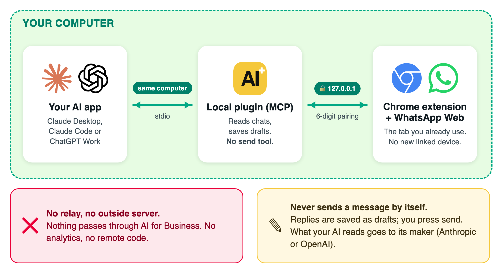

# WhatsApp Readonly MCP

**The private, secure WhatsApp MCP: your AI talks straight to your own WhatsApp Web. No relay, no servers in between, never sends.**

Claude, ChatGPT or Codex reads the WhatsApp Web tab you already have open, finds who is waiting for your reply, summarises groups and saves reply drafts. **Private:** everything runs on your computer, and your chats never pass through us. **Secure:** the plugin talks to the Chrome extension over `127.0.0.1` only, after a 6-digit pairing. There is no relay and no server of ours in between, and no new linked device on your WhatsApp account.



[](https://github.com/aiforbusiness-hq/whatsapp-readonly-mcp/actions/workflows/test.yml)


WhatsApp Readonly MCP is a **[Model Context Protocol](https://modelcontextprotocol.io) (MCP) server plus a Chrome extension** for WhatsApp Web. It reads your chats and saves reply drafts, and **never sends a message by itself**. The Chrome extension reads the WhatsApp Web tab you already have open. The local MCP server gives that data to your AI app on the same computer. Nothing goes through our servers. We run none.

In the stores the product is called **AI for Business Chat Assistant**, by AI for Business.

> **Unofficial.** Not affiliated with, endorsed or sponsored by WhatsApp or Meta. "WhatsApp" is used only to say which website this works with. WhatsApp's terms limit automated access, so try it with a spare or work number first.

[中文说明](#中文说明) · [Compatibility](#compatibility) · [Install](#install) · [Tools](#mcp-tools) · [Security](#security-design) · [FAQ](#faq) · [Test cases](#test-cases) · [Privacy](PRIVACY.md) · [Disclaimer](#disclaimer)

---

## Why this exists

For people who use AI every day and often need its help with WhatsApp: who is waiting for a reply, what a busy group said, a first draft of an answer. It is a convenience, not a way around WhatsApp.

- **Never sends a message by itself.** It reads your chats and saves reply drafts; you read each draft and press send yourself.
- **Not for spam or bulk messaging.** There is no send, broadcast, forward or auto-reply feature, and there never will be.
- **Doesn't get around WhatsApp.** It reads the WhatsApp Web tab you already use, logged in as you. No new linked device, no unofficial account, no scraping of other people's chats.
- **Only on your own computer.** It works only on the computer where your Claude or ChatGPT desktop app is open, with WhatsApp Web open in Chrome. Nothing runs in the cloud.

## What you can ask

- "Who is waiting for my reply?"
- "Summarise what the parents' group talked about today."
- "Find the message where Alex sent the invoice."
- "Draft a polite reply to the last customer who asked about prices."
- "Download the PDF in that message."

You do not have to say "WhatsApp": the AI reads your chats and saves reply drafts on its own when a question is about messages, customers or replies. A draft appears above the WhatsApp message box and first on the extension's Overview page, and **you** press send.

## Why it never sends

Most WhatsApp MCP servers log in as a new linked device and include a "send message" tool. This one is different:

| | WhatsApp Readonly MCP | Typical WhatsApp MCP / bot |
|---|---|---|
| Can send, reply, forward, delete | **No: there is no code for it** | Yes |
| Marks messages as read | **No** | Often |
| How it connects | The WhatsApp Web tab you already use | A new linked device or session |
| Where data goes | Only your computer and the AI app you chose | Depends on the project |
| Outside servers, analytics | **None** | Varies |
| Dependencies | **0** (hand-written MCP + WebSocket) | Many |

## Compatibility

| App | Mode | Works | How |
|---|---|:---:|---|
| Claude Desktop | Chat | ✅ | `aiforbusiness-chat-assistant.mcpb` desktop extension |
| Claude Code | CLI / desktop | ✅ | Plugin marketplace in this repo |
| ChatGPT desktop | **Work** | ✅ | Plugin marketplace in this repo (installed through Codex) |
| ChatGPT desktop | **Chat** | ❌ | Chat mode can't use local plugins. Switch to Work |
| Codex | CLI / desktop | ✅ | Plugin marketplace in this repo |
| Claude or ChatGPT on the web or phone | — | ❌ | They can't reach a program on your computer |
| Any other MCP client | stdio | ✅ | `node plugins/aiforbusiness-chat-assistant/server/server.js` |

Needs Google Chrome (version 116 or newer), WhatsApp Web logged in, and Node.js 18 or newer. Runs on macOS and Windows.

## Install

### 1. Chrome extension

1. Download the release zip, or build it yourself: `sh mcpb/build.sh && sh scripts/build-release.sh`. The zip lands in `dist/`.
2. Open `chrome://extensions`, turn on **Developer mode**, press **Load unpacked**, and choose the `extension` folder.
3. Open `https://web.whatsapp.com` and log in.

### 2. Connect your AI app (pick one)

**Claude Desktop:** double-click `aiforbusiness-chat-assistant.mcpb`, then press **Install**.

**Claude Code:**

```
/plugin marketplace add aiforbusiness-hq/whatsapp-readonly-mcp
/plugin install aiforbusiness-chat-assistant@aiforbusiness
```

**ChatGPT desktop / Codex:**

```bash
codex plugin marketplace add aiforbusiness-hq/whatsapp-readonly-mcp
```

```bash
codex plugin add aiforbusiness-chat-assistant@aiforbusiness
```

**Any other MCP client** (stdio):

```json
{ "mcpServers": { "whatsapp-readonly": { "command": "node", "args": ["/path/to/plugins/aiforbusiness-chat-assistant/server/server.js"] } } }
```

### 3. Pair once

Ask your AI: "What's my WhatsApp status?" It shows a 6-digit code such as `123 456`. Click the extension icon in Chrome and type the code within 3 minutes. You only do this once.

Step-by-step guide for students (Chinese): [`docs/安装说明.md`](docs/安装说明.md)

## MCP tools

| Tool | Type | What it does |
|---|---|---|
| `get_status` | read | Is WhatsApp Web open, is the extension connected and paired; gives a pairing code if not |
| `list_chats` | read | List chats, with filters for unread, groups or a keyword |
| `get_messages` | read | Latest messages of one chat (up to 100) |
| `search_messages` | read | Search stored messages, including captions, file names, locations, contacts and polls |
| `list_awaiting_reply` | read | Chats where the other person spoke last and you have not replied |
| `get_media` | read | Look at a photo, sticker or file already on this computer |
| `download_media` | download | Save one photo, video, voice note or document to Downloads, after a malware check |
| `save_draft` | draft | Save a reply draft. It is never sent |
| `list_drafts` | read | Drafts, and what you actually sent, for comparison |

Every tool declares MCP annotations (`readOnlyHint`, `destructiveHint: false`, `idempotentHint`, `openWorldHint`), so the AI app can tell reading from writing.

## Security design

- **Never sends.** The code has no send, Enter key, mark-as-read or delete path. Filling a draft into the box and opening a chat only react to real clicks (`event.isTrusted`).
- **Local only.** The server listens on `127.0.0.1` only and accepts the extension's fixed origin only. Any web page is refused.
- **Pairing.** A 6-digit code with SPAKE2 (RFC 9382, P-256): each try can test one guess only, even for a program that records everything. The code lasts 3 minutes, with 5 tries per code and 12 per run. After pairing, both sides prove they hold a 256-bit secret with HMAC. The secret never crosses the wire.
- **Downloads are checked.** Only types that can be checked completely are saved: photos, video, audio, text, PDF and modern Office. Programs, archives, macros, dangerous PDF actions, DDE fields and spreadsheet formulas are refused. A check that cannot finish refuses the file.
- **No outside network.** No analytics, update checks, remote code or web fonts. The only outside request is `download_media` fetching one file from WhatsApp's own media server.
- **You can wipe it.** The dashboard's **My data** page shows everything stored and clears it, after a confirmation.

Full design notes (Chinese): [`docs/ARCHITECTURE.md`](docs/ARCHITECTURE.md)

## FAQ

**Can Claude read my WhatsApp messages?**
Yes. With this extension and MCP server, Claude Desktop or Claude Code can read the WhatsApp Web chats open in your Chrome, on your own computer.

**Can ChatGPT read WhatsApp?**
Yes, through the ChatGPT desktop app or Codex with this plugin installed.

**Can the AI send WhatsApp messages with this?**
No. There is no send feature at all. The AI can only save drafts. You read a draft and press send yourself.

**Is my WhatsApp data uploaded anywhere?**
Not to us. Data stays on your computer. When you ask your AI a question, that AI app sends what it reads to its own provider (Anthropic or OpenAI) to answer you, as with anything else you ask it.

**Does it work on my phone?**
The extension needs WhatsApp Web in Chrome on a computer that stays on. You can then ask from your phone through a remote session of an AI app running on that computer, such as Claude Code Remote Control. The normal Claude or ChatGPT phone apps cannot reach it.

**Will WhatsApp ban my account?**
It might. This tool only reads, which lowers the risk, but WhatsApp's terms limit automated access. Use a spare or work number first.

**Does it mark messages as read?**
No. Reading through the extension does not open the chat or send read receipts.

**Does it need the WhatsApp Business API?**
No. It reads the normal WhatsApp Web you already use. No API key, no Meta developer account.

## Test cases

62 automated tests run on every push (see the badge). One more end-to-end test runs locally in a throwaway Chromium before each release. All tests use fake WhatsApp data, test ports and a test data folder. They never touch a real account or a real pairing.

```bash
node --test tests/*.test.mjs
```

```bash
CHROMIUM_PATH=/path/to/chromium node --test tests/download.e2e.mjs
```

| File | What it proves |
|---|---|
| [`pake.test.mjs`](tests/pake.test.mjs) | Pairing (SPAKE2): both sides use the same code file; the right code pairs; a wrong code fails; bad curve points are refused; a recorded try cannot be used to test other codes offline |
| [`rogue.test.mjs`](tests/rogue.test.mjs) | A fake local program learns nothing and can do nothing; it never gets the code; a relay on another port cannot reuse proofs; pairing is closed unless a code was just shown, with a fixed try budget |
| [`hub.test.mjs`](tests/hub.test.mjs) | 25 AI sessions share one connection; a crashed leader is replaced without losing requests; drafts are never saved twice; wrong tokens, web origins and wrong hosts are refused; it listens on `127.0.0.1` only |
| [`scan.test.mjs`](tests/scan.test.mjs) | Malware check: programs refused by content and by name; disguised files, hidden archives, web pages, dangerous PDF actions, Office macros, DDE and spreadsheet formulas refused; unfinished checks refuse the file; a hostile PDF cannot freeze the extension |
| [`media.test.mjs`](tests/media.test.mjs) | The reader cannot send, open chats or use the network; every message type is read correctly in a real headless Chrome; pictures reach the AI over MCP; downloads only happen on a paired MCP request, only from WhatsApp's media server |
| [`reader.test.mjs`](tests/reader.test.mjs) | Name lookups cannot be hijacked by look-alike groups or people named "Me"; view-once media is always refused; ambiguous names list exact matches first |
| [`card.test.mjs`](tests/card.test.mjs) | A draft is only ever filled into the chat it was written for, even while you switch chats |
| [`storage.test.mjs`](tests/storage.test.mjs) | Clearing drafts or the activity log is never undone by a write in flight; two AI apps saving at once keep both drafts; hostile file names are handled fast |
| [`i18n.test.mjs`](tests/i18n.test.mjs) | Screens are in English by default, even in a Chinese browser; Chinese only when the user picks it; clearing settings goes back to English |
| [`download.e2e.mjs`](tests/download.e2e.mjs) | End to end in a real Chromium with the real extension and server: pair, download, refuse malware, and check the My data page |

## Repository layout

| Path | What |
|---|---|
| `extension/` | Chrome extension (Manifest V3) |
| `plugins/aiforbusiness-chat-assistant/` | Plugin for Claude Code and ChatGPT/Codex, with the local MCP server in `server/` |
| `mcpb/` | Claude Desktop extension (`.mcpb`) build |
| `.claude-plugin/`, `.agents/plugins/` | Plugin marketplaces for Claude Code and Codex |
| `tests/` | Automated tests |
| `docs/` | Install guide, architecture, store listing text |

## Making a release

```bash
sh scripts/release.sh
```

It checks that every version number matches, runs the tests, builds `dist/aiforbusiness-chat-assistant.mcpb` and the release zip, tags `v<version>`, pushes the tag and publishes a GitHub Release with both files and `SHA256SUMS.txt`. Add `--dry-run` to build and check without tagging or publishing. Bump the version in all manifests first.

## Disclaimer

- **Use at your own risk. We are not liable for any loss.** This software is provided "as is", without warranty of any kind (see the [MIT License](LICENSE)). AI for Business is not responsible for any loss or damage from using it, including lost data, missed or wrong messages, or any action WhatsApp takes on your account.
- **For research and study.** This project is meant for personal research, study and learning how AI can help with your own chats. It is not meant for commercial use.
- **For business or commercial messaging, use an official route:** the [WhatsApp Business Platform (official API, WABA)](https://business.whatsapp.com/products/business-platform) or an authorised third-party WhatsApp API provider.
- **Unofficial.** Not affiliated with, endorsed or sponsored by WhatsApp, Meta, Anthropic or OpenAI. All trademarks and logos belong to their owners and are used only to show what this works with.
- **You are responsible** for following WhatsApp's Terms of Service and the laws that apply to you, including privacy law for other people's messages.

## Contributing

Issues and pull requests are welcome. Every change must keep the never-send rule: no code that sends, marks as read, deletes or changes anything in WhatsApp, and no outside network requests. Run `node --test tests/*.test.mjs` before opening a pull request.

## License

[MIT](LICENSE) © 2026 AI for Business

---

## 中文说明

**WhatsApp Readonly MCP**（商店名称：AI for Business Chat Assistant）让 Claude、ChatGPT 或 Codex 读你电脑上已经开着的 WhatsApp Web：谁在等你回、群里讲了什么、帮你起草回复。

- **绝不发送**：程序里没有发送、标已读、删除的功能；草稿由你自己按发送。
- **资料只在你的电脑**：不经过我们的服务器（我们没有服务器），没有统计、没有广告。
- **非官方**：跟 WhatsApp / Meta 没有关系。建议先用副号试。

**免责声明：** 使用风险自负，我们不对任何损失负责。本插件仅供研究和学习用途，不作商业用途。商业用途请使用 WhatsApp 官方 API（WABA）或其他第三方 WhatsApp API 服务商。

安装步骤：[`docs/安装说明.md`](docs/安装说明.md) · 技术说明：[`docs/ARCHITECTURE.md`](docs/ARCHITECTURE.md)
